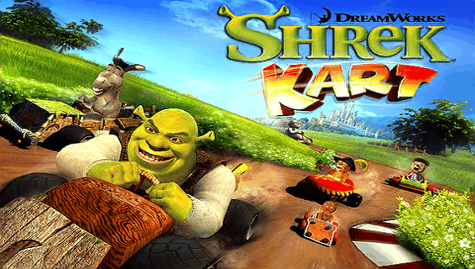

<h1 align="center">
  <br>
  Shrek Kart · PS Vita Port
</h1>

<p align="center">
  <a href="#-status--playability">Status & Playability</a> •
  <a href="#setup-instructions-for-players">How to install</a> •
  <a href="#controls">Controls</a> •
  <a href="#known-issues">Known Issues</a> •
  <a href="#build-instructions-for-developers">How to compile</a> •
  <a href="#credits--acknowledgments">Credits</a>
</p>

An unofficial, native **iOS-to-PS Vita wrapper port** of *Shrek Kart* (originally developed by **Gameloft**, iPhone). There is no `.so` here: this port ships its own **Mach-O loader** and **Objective-C runtime** that map the official armv6 iOS executable (`ShrekKarting`, from the 1.1.0 IPA) into PS Vita RAM and replace the Apple frameworks it uses (Foundation, UIKit, CoreFoundation, CoreGraphics, OpenAL, OpenGL ES) with native implementations on top of **vitaGL**, **openal-soft** and the Vita system libraries.

---

## 🎮 Status & Playability

**Status: IN-GAME (v1.0)**

On physical PlayStation Vita hardware the game boots through the Gameloft logo and menus into races, which run at a stable 25 fps (the game's own frame cap).

- [x] **Mach-O loader**: loads the armv6 executable at a fixed base (`MACHO_SLIDE = 0x98000000`), applies **21,977** rebase words, resolves **855** import slots (0 unimplemented), runs the **7** global constructors, and enters the game. *Verified on console.*
- [x] **ARMv6 VFP vectors**: the 9 `CMatrix` routines that use VFPv2 short vectors (not implemented by the Cortex-A9) are rewritten to NEON at load time. *Verified on console.*
- [x] **Graphics**: GLES 1.x → **vitaGL** (`SOFTFP_ABI=1`). The game's 320×480 portrait drawable is rotated to landscape and shown at 816×544 with side bars (aspect kept). `GL_OES_matrix_palette` skinning is emulated on the CPU (3–11 ms per frame in races). *Verified on console.*
- [x] **Performance**: races and menus at a stable **25 fps**, which is the limit set by the game's own render thread. *Verified on console.*
- [x] **Touch**: the front touchscreen is the iPhone screen. *Verified on console.*
- [x] **Controls**: the left stick steers by simulating phone tilt, and the physical buttons tap configurable points on the screen (see [Controls](#controls)).
- [x] **Audio**: sound effects and music through openal-soft, with the mixer on its own CPU core. Music decoding was fixed after the last console run (see [Known Issues](#known-issues)).
- [x] **Saves**: iOS `Documents/` is redirected to `ux0:data/shrekkart/Documents/`, and `NSUserDefaults` to `ux0:data/shrekkart/Library/Preferences/defaults.txt`.
- [x] **Offline bypasses**: Game Center, Bonjour/WLAN multiplayer and the iPod music picker are stubbed out. The intro video (`Shrek.m4v`) is skipped.
- [ ] **Button mapping**: the default `controls.txt` is not yet calibrated for the in-game buttons.
- [ ] **Trophies**: not implemented yet.

---

## Disclaimer

**Shrek** is a registered trademark of **DreamWorks Animation**, and *Shrek Kart* was developed and published by **Gameloft**. The work presented in this repository is unofficial and is not produced, endorsed, or sanctioned by DreamWorks Animation, Gameloft or any affiliated entities.

This software does NOT contain original game code, binaries, copyrighted graphics, or game assets. The authors do not promote or condone piracy in any way. To play, you must provide your own legally obtained, **decrypted** copy of the iOS `.ipa`.

---

## Setup Instructions (For Players)

1. **CFW & Plugins**: PS Vita on Custom Firmware (**Enso 3.60 / 3.65** recommended) with `kubridge` under `*KERNEL` in `ur0:tai/config.txt`:
   ```ini
   *KERNEL
   ur0:tai/kubridge.skprx
   ```
2. **Shader Compiler**: `libshacccg.suprx` must be in `ur0:data/` (extract it with **ShaRKBR33D**).
3. **Game Files**: a decrypted **Shrek Kart 1.1.0** iOS `.ipa` (FairPlay `cryptid 0`). Open it as a ZIP and extract `Payload/ShrekKarting.app/`. Other versions do not match `rebase.bin` / `binds.bin`.
4. **Copy to the Vita** (`ux0:data/shrekkart/`):
   ```
   ux0:data/shrekkart/
     game_app/      the contents of ShrekKarting.app from the IPA, untouched (renamed to game_app)
     rebase.bin     from the release (or generated with tools/ios_prep.py)
     binds.bin      from the release (or generated with tools/ios_prep.py)
     controls.txt   from the release — button-to-touch mapping
     Documents/     created automatically — your save games
     Library/       created automatically — game settings (NSUserDefaults)
     logs/          created automatically — shrekkart_001.log … one per run
   ```
5. **Install VPK**: install `shrekkart.vpk` with VitaShell.

---

## Controls

Physical buttons are translated into touches on the game screen. The touch points are edited in `ux0:data/shrekkart/controls.txt` (coordinates in the 480×320 landscape picture, origin top-left, up to 6 lines), no rebuild needed.

| Input | Action | Status |
| :---: | :--- | :---: |
| **Front Touchscreen** | iPhone touch screen (menus, HUD) | ✅ Working |
| **Left Stick** | Steering (sent as phone tilt) | ✅ Working |
| **Cross (✖)** | Taps (430, 270), bottom-right | ⚠️ Not calibrated |
| **Circle (●)** | Taps (50, 270), bottom-left | ⚠️ Not calibrated |
| **Square (◼)** | Taps (430, 50), top-right | ⚠️ Not calibrated |
| **Start** | Taps (240, 160), center | ⚠️ Not calibrated |
| **Select + Start (hold 2 s)** | Cycle picture rotation (saved to `rotation.txt`) | ✅ Working |

> [!TIP]
> Each line of `controls.txt` is `BUTTON X Y`. Valid names include `CROSS`, `CIRCLE`, `SQUARE`, `TRIANGLE`, `LTRIGGER`, `RTRIGGER`, `START`, `SELECT` and the D-Pad (`UP`, `DOWN`, `LEFT`, `RIGHT`).

---

## Known Issues

- **Music after the latest fix**: the Musepack music played as noise because 55 decoder table words were rebased as pointers. `rebase.bin` was fixed (22,032 → 21,977 words) but this has not been checked on console yet.
- **Button mapping**: the default touch points in `controls.txt` are placeholders; use the touchscreen when a button does not hit the right spot.
- **Short stalls in menus**: frame-rate drops while the game loads `.bar` resource files.
- **Saves**: writing to `Documents/` works, but persistence across restarts has not been verified yet.
- **Online features disabled**: Game Center, local WLAN multiplayer and the iPod music picker are bypassed by design.
- **Crash dumps** are written by the system to `ux0:data/` (not to the game folder).

---

## Build Instructions (For Developers)

### Prerequisites

- [VitaSDK](https://vitasdk.org/) (`$VITASDK`, softfp) with `vitaGL` (vendored), `vitashark`, `openal-soft`, `libvorbis`, `freetype`, `libpng`, `zlib`, `bzip2` and `mathneon`.
- CMake 3.14+, Python 3 (for the tools).
- The decrypted `ShrekKarting.app` folder, linked as `game_app` in the repo root (never committed).

### Compilation Commands

```bash
git clone https://github.com/MetalSyntax/Shrek-Kart-vita.git
cd Shrek-Kart-vita
ln -s /path/to/Payload/ShrekKarting.app game_app

# Stage the console data (copies the .app, generates rebase.bin / binds.bin, default controls.txt)
tools/stage_data.sh

# Build eboot.bin / shrekkart.vpk
cmake -S . -B build
cmake --build build
```

### Deploy & Debug (over VitaShell FTP)

```bash
python3 -I tools/deploy_data.py          # incremental upload of ux0_data/shrekkart/ (never touches Documents/ or logs/)
python3 -I tools/deploy_data.py --logs   # fetch logs and crash dumps into ./logs/
```

A crash PC in `0x98xxxxxx` minus `0x98000000` is the address in the Mach-O (`python3 -I tools/annotate.py`). A data address below `0x02000000` usually means a missed rebase: look it up in `ux0_data/shrekkart/report.txt`. The `source/` runtime is shared with the other iOS ports (master copy in [`Ferrari-GT-Evolution-vita`](https://github.com/MetalSyntax/Ferrari-GT-Evolution-vita), synced with `tools/sync_runtime.sh`). Architecture and progress notes: [`PORTING_PLAN.md`](PORTING_PLAN.md) and [`port_progress.md`](port_progress.md).

---

## ☕ Support My Work

This project is **free** and will stay free. If you enjoy it, a tip from **$1** helps me keep porting games to the PS Vita:

<p align="center">
  <a href="https://ko-fi.com/metalsyntax"></a>
</p>

- **Ko-fi:** [ko-fi.com/metalsyntax](https://ko-fi.com/metalsyntax)
- **PayPal:** [paypal.me/MetalSyntax](https://paypal.me/MetalSyntax)
- **Bitcoin (BTC):** `133HdCsaWxdjTfmwpgGVykByhNBV338uRc`

**Ko-fi supporters get:**
- **Early access** to new ports before their public release (test builds of upcoming projects).
- **Data preparation scripts and step-by-step guides** to set up your own game files for each new port.
- A say in which games I port next.

> Game files are never distributed. You always need your own legally obtained copy of the game.

---

## Credits & Acknowledgments

- **Shrek Kart** is intellectual property of **Gameloft**; **Shrek** is a trademark of **DreamWorks Animation**.
- **vitaGL** graphics library by [Rinnegatamante](https://github.com/Rinnegatamante/vitaGL).
- **kubridge** plugin by [Bythos](https://github.com/bythos14/kubridge).
- **openal-soft**, **libvorbis**, **FreeType**, **libpng** and **zlib** projects.
- The **iOS Mach-O loader** is based on [`ios-loader-boilerplate`](https://github.com/MetalSyntax/ios-loader-boilerplate) and [`Inotia2-vita`](https://github.com/MetalSyntax/Inotia2-vita); the shared ObjC runtime lives in [`Ferrari-GT-Evolution-vita`](https://github.com/MetalSyntax/Ferrari-GT-Evolution-vita).
- Special thanks to the PS Vita homebrew and porting community.
